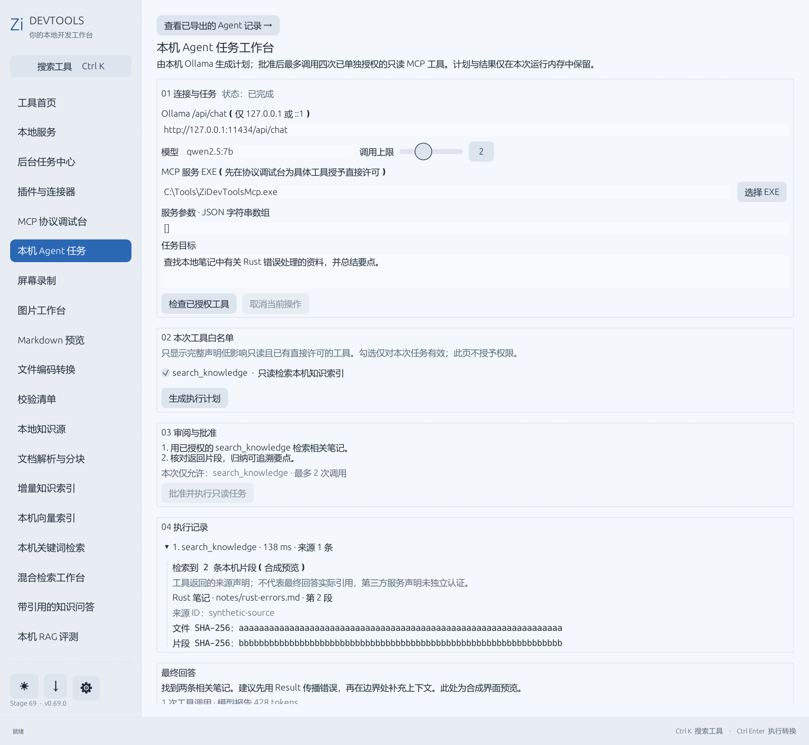

# 本机 Agent 任务工作台

从工具首页搜索“Agent”或左侧“本机 Agent 任务”进入。此工作台只连接本机回环地址的 Ollama `/api/chat`；默认模型 `qwen2.5:7b` 可改为本机已安装模型。MCP 目标须为可信的绝对 EXE 路径，参数填写 JSON 字符串数组。工作台不会自动发现或安装模型与服务。

其他工具的文本结果可以通过统一“发送结果到工具…”入口交给 Agent；任务成功完成后，统一接力栏也可把“Agent 最终回答”发送到其他兼容工具。接力来源标签显示目录中的 agent-runner ID 和工具版本，接收文本仍只包含回答正文，不包括计划、运行记录、MCP 原始结果或来源路径；回答中的引用编号保留为文字，但来源清单不随结果发送。失败、取消或运行中不会提供该输出。你也可以多选本机 UTF-8 文本或代码文件（TXT、Markdown、JSON、YAML、CSV、日志、源代码及常用配置）。读取只创建当前会话快照；每个文件及全部接力资料合计均最多32 KiB，最多32项。拒绝非 UTF-8、二进制内容、空文件和超限文件。多文件导入采用整体校验，任一文件或累计预算不符合要求时全部保持原样。界面只显示文件名，不保留完整路径。资料按来源预览，最新接收项自动展开，用户可逐条移除或全部清空；任何增删都会使旧计划失效，Agent 运行期间禁止修改接力资料。接力本身不会调用模型或 MCP；只有手动生成计划时，才把资料作为不可信数据发送给本机模型。任务目标仍单独限制为 2,000 字节，资料中的文字不能充当任务授权。

先到 [MCP 协议调试台](mcp-inspector.md)检查目标服务和工具定义。Agent 会列出没有被禁止的工具：只有同时声明 `readOnlyHint=true`、`destructiveHint=false`、`openWorldHint=false` 且完整定义已获直接许可的工具才可直接调用；其他工具每次调用前都会停下来，显示确切工具名和 JSON 参数，等待用户仅批准这一次或拒绝并停止任务。批准计划不等于批准所有后续写操作。服务端声明不是沙箱或代码审计；工具可能产生无法撤销的副作用，只对可信服务授权。可选用同目录的 [Zi 知识库 MCP 服务](knowledge-mcp.md)读取已手动同步的本机索引。

在工作台填写目标、选择本次工具白名单和最多 1–4 次调用，点击“生成执行计划”。规划请求不附带工具，模型只能生成可审阅的文字；此时没有调用 MCP 工具。审阅计划后点击“批准计划并执行”，才会向模型提供所选工具 schema。每次调用都必须匹配白名单，并重新核对服务程序和直接文件参数、完整工具定义与当前权限文件；需逐次确认的工具会在调用前停住，显示参数供检查。模型要求其他工具、一次多个调用、工具定义改变、用户拒绝、等待确认时取消或权限撤销时，任务停止且不发送待处理调用。改变输入、模型、服务或白名单会废弃旧计划。

任务显示草稿、检查、规划、待批准、执行、完成、失败和取消状态，以及每次工具的耗时与不含原始内容的结果摘要。调用 `search_knowledge` 后，Agent 从结构化命中按消息大小选取片段，避免 MCP 文本包装重复占用模型上下文；步骤列表只显示已选入下一轮模型消息的来源，最多十条。展开可查看 `[K1]` 等编号、来源名称、相对路径、位置和文件/片段 SHA-256，步骤不保存检索正文。完成任务的模型回答若写出 `[K编号]`，必须来自本次已传入的片段，否则拒绝该答案；未提供引用时仍显示回答，但明确提示缺少可核对引用。失败或取消时，最近一步选入的消息可能尚未发送。编号有效不证明陈述事实正确，第三方同名工具的来源声明也未经独立认证。模型每轮最多生成 512 tokens，总计上限为模型报告的 12000 tokens，包含生成计划、工具调用与最终回答的 prompt/生成用量；每次 Ollama 响应都必须给出有效的 `prompt_eval_count` 和 `eval_count`，否则任务停止，且不会继续调用 MCP 工具。审批界面显示规划阶段已报告的用量。请求最多 64 KiB，响应最多 128 KiB，工具参数最多 8 KiB，下一轮模型消息中单次工具结果最多 3 KiB。单个模型请求最长 45 秒，MCP 检查最长 15 秒、调用最长 30 秒。用户可取消当前模型请求或 MCP 短会话；已经交给外部服务的操作无法回滚。

Agent 的授权检查、计划生成和批准执行会同步到全局后台任务中心；切换到其他工具后仍持续收取状态，并可在那里取消当前 generation 或返回本工作台。任务中心仅显示阶段与通用终态摘要，不保存任务目标、计划、回答、MCP 参数、工具结果或错误正文；详细状态仍由本页面展示。

计划、结果与执行记录默认仅在当前进程内存中，不自动写文件、其他应用配置或长期历史。执行完成、失败或取消后，可在“运行记录导出”中预览 JSON 并主动选择保存路径。所有导出均使用 schema v5。默认文件只含状态、模型名、已批准的工具名、调用耗时、内容项数量/结果字节摘要、成功时模型报告的 token 用量，以及 Agent 工具独立版本和便携运行环境指纹；不含任务目标、接力资料、计划、答案、错误文字、来源路径、服务程序/权限路径、工具参数或 MCP 原始结果。勾选“额外包含”才写入目标、接力资料、计划、答案、错误文字及已有的来源声明；来源编号与答案引用列表继续严格核验。v1–v4 旧记录仍可读，但不含 v5 的生成工具版本和运行环境指纹。保存预览与最终文件内容一致。失败或取消时 token 用量显示为 null，不推断未收到的模型统计。编辑任务输入会废弃旧记录。导出的工具名等元数据也可能敏感，分享前请检查。

任务工作台不导入记录或自动重放任务；当前只支持本机 Ollama + 本机 stdio MCP。对非直接只读工具，逐次确认仅表示用户决定发送这次调用，不构成进程沙箱、数据范围隔离或副作用回滚；仍不支持后台自主运行、费用计费、断点恢复或其他客户端审批。
导出的 JSON 可在独立的 [Agent 记录查看器](agent-record-viewer.md)中只读打开和按步骤查看；查看器不会恢复或重新执行任务。
